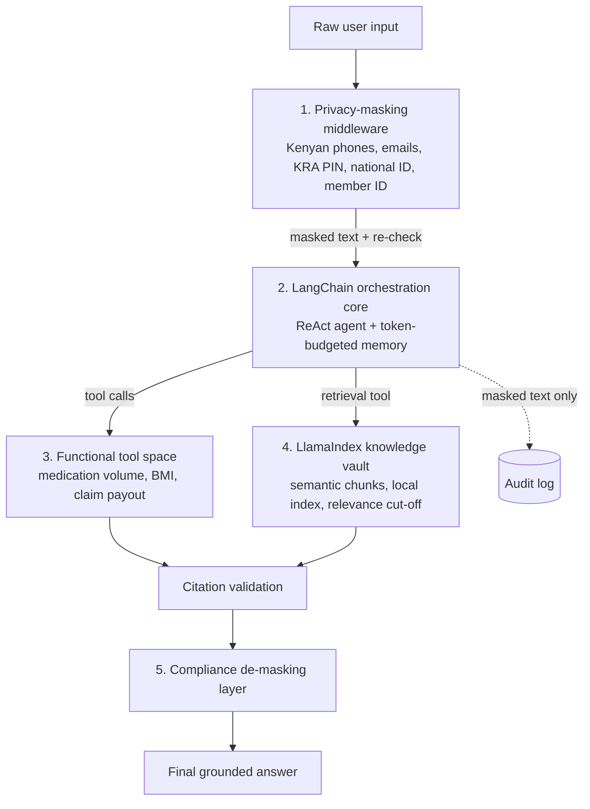

# AfyaPlus Enterprise RAG Agent System (Week 2 Capstone)

An audit-ready assistant for AfyaPlus Health that answers insurance verification and clinical routing
questions. It grounds every policy answer in a LlamaIndex knowledge vault, performs calculations only
through validated tools, remembers the conversation, and never sends personal identifiers to the model.



## Project layout
| Path | Purpose |
|---|---|
| `afyaplus/privacy.py` | PII detection, masking, de-masking (per-session token vault) |
| `afyaplus/knowledge.py` | Ingestion, semantic chunking, embeddings, persisted index, retriever tool |
| `afyaplus/tools.py` | `@tool` calculators with type hints, docstrings and input validation |
| `afyaplus/agent.py` | Agent construction, session memory, citation validation, audit log |
| `afyaplus/config.py` | All tunable settings (overridable in `.env`) |
| `knowledge_manual/` | Source documents (fictional AfyaPlus policies) |
| `tests/` | Unit tests for masking and tools (no API key needed) |
| `sample_outputs/demo_transcript.md` | Five-turn demo showing masking, RAG, tools and memory |

## Setup and run
```powershell
python -m venv .venv
.\.venv\Scripts\Activate.ps1
pip install -r requirements.txt
copy .env.example .env      # then add your OPENAI_API_KEY
python -m pytest            # unit tests (offline)
python main.py --build-index
python main.py --demo       # writes sample_outputs/demo_transcript.md
python main.py --show-masked
```

## Orchestration design choices
- **One reasoning model, one retrieval engine.** LlamaIndex does what it is best at (ingestion, chunking,
  vector search). The LangChain agent does the reasoning and writing. The retriever returns excerpts rather
  than a LlamaIndex-synthesised answer, so there is a single LLM call chain, lower cost, and citations that
  map exactly to stored chunks.
- **ReAct tool-calling agent** (`langchain.agents.create_agent`, with a fallback to LangGraph's prebuilt agent
  on older versions). The model decides when to retrieve and when to calculate. The system prompt enforces:
  retrieve before answering policy questions, calculate only through tools, never choose a dose.
- **Four tools only** (one retriever + three calculators), each with a narrow, clearly described purpose, so
  the model is not confused by overlapping tools.
- **Structured tool results.** Every calculator returns JSON with `status: ok | error`. Invalid input becomes a
  readable error the agent can act on (for example, by asking the user), never a crash. LangGraph's tool node
  also converts unexpected tool exceptions into messages.
- **Bounded execution.** `temperature=0`, a recursion limit of 12 steps, a 30 s request timeout, and specific
  handling of `APITimeoutError`, `APIConnectionError`, `RateLimitError` and `GraphRecursionError`.

## RAG pipeline
| Stage | Choice | Why |
|---|---|---|
| Parsing | `SimpleDirectoryReader` over `knowledge_manual/` (.md, .txt) | Local guidelines, file name kept as metadata for citations |
| Chunking | `SemanticSplitterNodeParser` (breakpoint 90th percentile), tiny fragments merged (<120 chars), oversized chunks re-split (>1,500 chars, 300-token fallback) | Chunks follow topic boundaries; each one is a precise, citable unit |
| Embeddings | OpenAI `text-embedding-3-small` | Strong quality for the cost |
| Storage | LlamaIndex local persistence in `storage/`, with a content fingerprint | Index is rebuilt only when documents or settings change |
| Retrieval | Top-4, cosine relevance cut-off 0.30 | Irrelevant chunks are dropped; if nothing passes, the tool returns `NO_RELEVANT_CONTEXT` |
| Validation | Every excerpt carries a `[source: file#id]` tag; citations in the answer that were not actually retrieved are removed and logged | Prevents fabricated citations; makes answers auditable |

Use `python main.py --search "your query"` to see raw relevance scores when tuning the cut-off.
Index statistics (documents, chunks, chunk sizes) are written to `storage/manifest.json` on every build.

## Token management
- **Sliding-window memory:** before each turn, history is trimmed to a 3,000-token budget with
  `trim_messages(strategy="last", start_on="human")`. The oldest turns drop first, and a tool call is never
  separated from its result.
- **Token counting** uses the gpt-4o tokenizer (`o200k_base` via tiktoken), including tool-call arguments.
- **Retrieval is bounded:** at most 4 excerpts of up to 1,500 characters each per search.
- **Per-turn visibility:** history size and latency are printed for every turn and recorded in the audit log.

## Compliance guardrails (Kenya Data Protection Act, 2019)
| Identifier | Formats detected | Token |
|---|---|---|
| Mobile phone | `07xx…`, `01xx…`, `+254`, `254`, `(+254)`, with spaces or dashes in any grouping | `[PHONE_n]` |
| Nairobi landline | `020 xxx xxxx`, `+254 20 …` | `[PHONE_n]` |
| Email | Standard addresses, including `+tags` and subdomains | `[EMAIL_n]` |
| KRA PIN | `A123456789Z` / `P…` | `[KRA_PIN_n]` |
| National ID | 7–8 digits, only next to an "ID" keyword | `[NATIONAL_ID_n]` |
| AfyaPlus member number | `AFP-123456` | `[MEMBER_ID_n]` |

- **Data minimisation:** identifiers are replaced *before* any text leaves the machine, so the cloud model and
  the embedding service never receive them. This also limits cross-border transfer of personal data.
- **Defence in depth:** the masked text is scanned again; if anything is still detected, the request is blocked.
- **Stable tokens:** the same number in different formats gets the same token, so memory works without the
  model ever seeing the real value.
- **De-masking only at the very end:** originals are re-inserted into the final, approved answer for the
  authorised user, and nowhere else.
- **PII-free audit trail:** `logs/audit.jsonl` stores masked input, tools used, sources, invalid citations,
  token counts and latency, but never raw identifiers or the de-masked answer.
- **Clinical safety:** the agent never chooses a medication dose, and every calculated volume carries a
  "confirm with the prescriber or pharmacist" note.

**Known limitations:** person names and physical addresses are not masked (named-entity detection would be the
next step). Landline detection covers Nairobi (020) only. Over-masking is possible for a 10-digit reference
number that looks like a mobile number, which is the safe direction.

## Testing
`python -m pytest` runs the masking tests and the tool tests, including edge cases and invalid inputs, with no
API calls. `python main.py --demo` exercises the full pipeline end to end. The transcript shows the masked
text the model received next to the de-masked answer the user saw.

## Git workflow
Developed on `feat-rag-agent-system` with semantic commits (`feat(privacy)`, `feat(rag)`, `feat(tools)`,
`feat(agent)`, `test`, `docs`) and merged into `main` through a reviewed pull request.